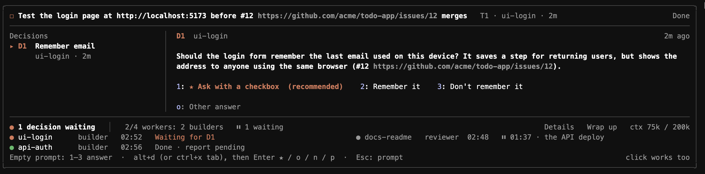
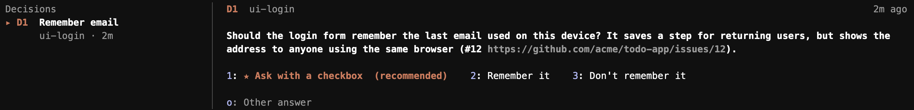
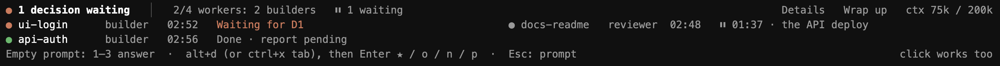

# claude-herdr-orchestrator

Run a team of coding agents from one Claude Code session. The coordinator plans the work, starts workers (Claude, opencode, codex) in [herdr](https://herdr.dev) tabs, and their reports come back to it as prompts. You answer the questions only you can answer from a panel above the prompt.



Install it from the plugin marketplace, at a Claude Code prompt (details under [Install](#install)):

```
/plugin install herdr-agents --marketplace contursofran/claude-herdr-orchestrator
```

## Discord

A bot can post the work to a private Discord server: questions in `#decisions` and to-dos in `#to-do`, both mentioning you; PRs merged or ready to review in `#updates`; a daily summary in `#metrics`. An item you close in Herdr is struck through in Discord.

An item with screenshots or recordings (the `images` field of `ask_owner` and `pin_for_owner`) goes to `#review` with its files attached; news goes to `#updates` only when it has images. Files must be pictures or videos, up to 10 MB in all on one message.

Questions have a button per option and to-dos a Done button. A tap does what answering in Herdr does, and only the server's owner, named in `ownerId`, can answer. Questions that mention a deploy, release, promotion or production have no buttons and say to answer in Herdr, as do questions with no options.

1. Create a bot in the [Discord developer portal](https://discord.com/developers/applications) and invite it to your server, with View Channels, Send Messages, Embed Links, Attach Files and Manage Channels.
2. Save its token in `~/.herdr-agents/discord-token` (`chmod 600`), and write `~/.herdr-agents/discord.json`: `{ "guildId": "…", "ownerId": "your user id", "only": ["~/code/personal"] }`. `only` lists the folders that may post. Leave it out and every folder posts, so list them if some of your work shouldn't reach Discord.
3. Run `app/discord/service.sh install`. It runs on macOS while you're logged in. The first look posts nothing; `uninstall` stops it.

## Features

### Workers in herdr tabs, on any model

The coordinator starts each worker in its own herdr tab, in its own git worktree, with a profile (`spawn` with `branch` creates (after fetching the base from origin, if the repo has one) the worktree at `../<repo>-wt/<branch>` itself; `cwd` reuses an existing folder, e.g. for a fix round): the built-in planner, builder, reviewer and debugger, or your own on Claude, opencode or codex (`smallTasks` sends the small ones to a cheap model). A worker's first-run "trust this folder?" prompt is answered for it. Each worker is an hc terminal (`hc run --no-parent`, labelled so Herdr shows it in a tab of the coordinator's space) with `HERDR_AGENTS_ROLE=worker`; the mod also loads in a Claude worker's own session, which runs none of its timers; for the workers it started, it sweeps and checks their reports only while one of them runs, and closes their tabs once they sit idle after their reports.

### Reports come back by themselves

When a worker finishes, its `RESULT.md` comes back to the coordinator as a prompt; no polling, no copying. It shows in the chat as one dim line (ctrl+o for the full report). Workers start `RESULT.md` with a short header (status, PR, a 3-line summary); the coordinator gets the summary and the file's path, and reads the rest only when it needs to. Reports without a header are shortened to a pointer when long. hc tells the mod the moment a worker ends its turn (`hc events`), and a `RESULT.md` is delivered within 6 seconds of landing, once the file has stopped changing, even while its worker is still finishing its turn (a non-Claude worker's messages wait for the end of its turn, and a block after its report is reported too). A sweep each minute, with one `hc ls` for all workers, catches anything missed, and a slow send to one worker doesn't hold up its checks of the others; a single failed hc call never ends a job. A worker that goes back to work after a `blocked` or `error` report with no `RESULT.md` written counts as running again; a worker that went `blocked` keeps counting as working for its first 3 minutes, so the report doesn't ask for a replacement of one about to resume, and a CLI that keeps erroring is reported once per prompt. The `<herdr-agent>` tag carries the worker's status: `done`, `blocked`, `error` (its CLI reported an error), `failed` (also a worker that did not start) or `gone` (its tab is gone, with the messages held for it that were not sent). Reports, your answers and ticked to-dos that arrive within a few seconds, or while the coordinator is busy, reach it as one prompt.

### To-dos pinned for you

What only you can do (test a build, merge a PR, restart something) is pinned at the top of the panel, so it doesn't scroll away in a report. Tick Done and the coordinator carries on from it; it unpins what is no longer needed.


### Decisions, with options and a recommendation

Questions that are yours (a product rule, a design choice, an approval) wait on the panel with their options and the recommended one starred, and the panel toasts you; Herdr's own sound and toast cover a worker that blocks or finishes. Answer with `1`–`4` from an empty prompt, with alt+d and the arrows, or with a click; `o` gives your own answer. A `#12` links to that issue or PR.



### Only your questions reach you

Workers ask with `DECISION:` lines. The coordinator settles the ones that aren't yours, and the panel shows each answer with a ✓ for ten minutes, so you can overrule it.

### Every worker at a glance

Role, time and state for each worker: working, waiting on you, done. Four fit in the compact view; Details shows them all. A worker waiting on CI or a deploy leaves a `WAIT.json` with a check to run; the mod runs it and wakes the worker when it passes, with no model running meanwhile (⏸ and what it waits for).



### Auto-compact at 250k

The panel shows the coordinator's context (`ctx 75k / 250k`). Past `resetAt` (250k tokens) the coordinator writes its state to `COORDINATOR-STATE.md` (the mod keeps its Workers block current itself) and is compacted, then reads it back before the next report, so a session can run all day.

### A playbook that keeps workers busy

Builder, then reviewer; the builder plans for itself, and the planner goes first only for work that needs several PRs or leaves the approach open. Each fix round goes to a fresh builder, and the debugger takes over after two failed rounds. The coordinator is reminded when fewer than `target` workers run.

### Learning notes

Off by default. When agents do the building, you see a lot of new ideas go by without learning them. With `learningNotes` on, the coordinator leaves an Obsidian note for each concept the session worked with (garbage collection, WebSockets, a build cache) when it wraps up, or when you run `/hrd-notes`. A note has the title, where the concept came up (issue, PR or file), `[[links]]` to related notes and two or three questions, and an empty **My explanation** for you to write. The coordinator never writes the explanation and never edits your text; a concept that already has a note only gets a new "Seen in" line. Only the coordinator writes notes, once per run, so workers spend nothing on it.

### Wrap-up and cleanup

`/hrd-wrap-up`, or the panel's Wrap up button, starts no new workers and lets the running ones finish; herdr notifies you when the last one is done. Worktrees whose PR merged are removed every half hour, with their tabs and branches; each report is also kept in `~/.herdr-agents/reports/`, so the metrics outlive the worktree. A worker's tab closes once it has sat idle half an hour after its report, unless it has a question open; a follow-up after that goes to a fresh worker.

### Settings in a dialog

In the Herdr app: the sliders button in the strip, or ctrl+cmd+, in the `coordinator` layout. It edits the settings for all folders or just this one.

### The board for other apps

The work and what needs you are kept in `~/.herdr-agents/board/<session id>.json`, rewritten when it changes and removed when the session ends, so an app outside Claude Code (such as [contr](https://github.com/contursofran/contr), a native herdr client) can draw it. The app acts on it by dropping a JSON file in `<session id>.actions/` beside it: answer a decision, tick or dismiss a to-do, clear done, wrap up or keep going. The format is in [docs/board-schema.json](docs/board-schema.json).

### A Herdr app mod (work in progress)

`app/` holds a mod for the [Herdr app](https://herdr.dev) that will draw the board inside the window: a pin bar under the tabs and a needs-you strip under the terminal, for the coordinator of the space you are in (tracking issue [#93](https://github.com/contursofran/claude-herdr-orchestrator/issues/93)). Today it finds the right board as focus moves and draws one line in each row (the folder and how many items are open); the rest comes slice by slice. The mod follows Herdr's light or dark theme.

`./install.sh` installs it only when the app's folder exists (`$HERDR_APP_HOME`, default `~/.config/herdr-app`). It copies the mod, adds a layout called `coordinator` next to `main` (a copy of `main` with the two rows) and adds the mod's keys without replacing any key you use. It never switches your layout. To try it, switch yourself: your layout-switch key (`ctrl-shift-l` by default, `cmd-shift-l` in a Mac keys file) or `herdr-app do layout.switch --name coordinator`; to go back, `herdr-app do layout.switch --name main`. The board's `coordinator.terminal` field (the hc terminal the coordinator runs in) tells the mod which board is which, so sessions started before it was added draw empty rows until they reload. In the `coordinator` layout the agents list is a copy of Herdr's own (taken from herdr-app 0.1.9) with an **Orchestrators** section on top: the agents that are a live board's coordinator stay there whatever their state. Herdr's later changes to its list do not reach the copy, and pins and "time in state" start empty. Each install points the `coordinator` layout's agents list at the copy again, even if you put Herdr's own back there: that layout is ours, and Herdr's own list is what `main` is for. While the pin bar copy runs it writes `~/.herdr-agents/app-mod.json` every 30 s (and removes it when it closes), and the plugin's band steps aside for a session whose hc terminal the file lists; PR checks keep being polled. A switch to `main` removes the file at once; after a crash or hang it goes stale and the band returns within 90 s, by itself (the coordinator's timer redraws it), even on an idle session. If the pin bar, strip or card throws while drawing, the file lists no terminals until a later good draw, so the band comes back at the next tick. The file also names the hc core, so a second core on the same machine keeps its band. With no file, an old one, or a session on another machine, another core or outside hc, the band stays as before. The strip shows the coordinator's context against its limit (`ctx 145k / 250k`), with the band's warning and error levels. At the right of the status bar the layout shows the installed version and commit, from a `version.json` that `install.sh` writes into the installed mod. Tests: `npm run test:app`.

## What's in the repo

- **`herdr-agents`** (the mod): the `spawn`, `message` and `stop` tools for workers, `ask_owner`, `decided`, `pin_for_owner` and `unpin_for_owner` for the panel, and everything above.
- **`herdr-agents-view`** (`view/`): draws worker reports as one dim line. It has to be a separate mod, because Claude Code never raises a mod's own `ui.render` hooks for the prompts that mod submits.
- **Subagents** (`agents/`, shipped with the mod as `herdr-agents:planner`, `herdr-agents:builder` and `herdr-agents:reviewer`): `planner` (Opus high), `builder` (Sonnet medium) and `reviewer` (Opus high); the `debugger` profile is Opus with full tools. They hold no repo rules of their own: they read the repo's `AGENTS.md`/`CLAUDE.md` and its `.claude/skills` checklists.

## Install

You need the [Herdr](https://herdr.dev) app with `hc` ([herdr-core](https://github.com/herdrdev/herdr-core)) and Claude Code. At the prompt of a Claude Code session:

```
/plugin install herdr-agents --marketplace contursofran/claude-herdr-orchestrator
/plugin install herdr-agents-view@claude-herdr-orchestrator
```

Answer `y` to add the marketplace, then pick the user scope. The first installs the mod and its planner, builder and reviewer subagents; the second draws worker reports as one line. Start new sessions inside a Herdr terminal (or with `hc run --bg claude`) to use it.

The first time the coordinator uses one of the mod's tools (`spawn`, `ask_owner`, …), Claude Code asks; choose "don't ask again", or allow them all at once in `~/.claude/settings.json`:

```json
{ "permissions": { "allow": ["mcp__herdr-agents"] } }
```

Optional: bind alt+d to move into the panel (ctrl+x tab works without it) in `~/.claude/keybindings.json`:

```json
{ "bindings": [{ "context": "Chat", "bindings": { "alt+d": "abovePrompt:focus" } }] }
```

### Updates

Each release bumps the version in `plugin.json`. Run `claude plugin update herdr-agents@claude-herdr-orchestrator` (and the same for `herdr-agents-view`), or update them from `/plugin`, then start a new session. Watch the repository's releases on GitHub to hear about new versions.

## Use it in a repo

1. **Rules.** Add the section in [`templates/AGENTS.md`](templates/AGENTS.md) to the repo's `AGENTS.md` (or `CLAUDE.md`) and fill it in: base branch, checks, how to update a branch, commit identity, who merges, what needs you. Every worker reads it, so this is where repo-specific rules go, not the subagents.
2. **Settings (optional).** A `.claude/herdr-agents.json` in the folder you coordinate from overrides `~/.claude/herdr-agents.json` for that folder, e.g. `{"target": 2}`.
3. **Start.** Inside herdr, open the repo folder and run `claude --model opus --effort medium`, then `/hrd-orchestrate <goal>`, e.g. `/hrd-orchestrate the issues labelled ready`. The session gets the coordinator playbook (state file, worktree per worker, builder → reviewer with a planner for big work, when to ask you) and starts workers.
4. **Stop.** `/hrd-wrap-up` (or the panel's Wrap up button) starts no new workers and lets the running ones finish; you get a toast when the last one is done. `/hrd-wrap-up off` (Keep going) resumes.

One coordinator per folder: its notes live in `COORDINATOR-STATE.md` there (the mod keeps its Workers block current itself), and wrap-up applies to the coordinators of that folder.

## Commands

All start with `hrd-` (`commandPrefix` changes it).

| Command | What it does |
| --- | --- |
| `/hrd-orchestrate <goal>` | Make this session the coordinator, with the playbook and a goal. |
| `/hrd-wrap-up`, `/hrd-wrap-up off` | Stop starting workers and let the running ones finish; resume. |
| `/hrd-notes` | Leave learning notes now for the concepts this session worked with (needs `learningNotes`). |
| `/hrd-update` | Pull the clone this mod was installed from (`git pull --ff-only`), then run its `install.sh` again. It answers with the commits and version; running sessions reload the new version by themselves. |
| `/hrd-config` | Says where the settings are. |
| `/hrd-help`, `/hrd-h` | A short guide: the commands, the panel's keys, and the profiles and settings in effect for this folder. |

## Settings

Change them in the Herdr app's settings dialog, or by hand in `~/.claude/herdr-agents.json` (in `$CLAUDE_CONFIG_DIR` when set), with `<folder>/.claude/herdr-agents.json` over it (`profiles` merge by name):

| Key | Default | Meaning |
| --- | --- | --- |
| `target` | `4` | Workers the coordinator keeps busy. |
| `resetAt` | `250000` | Context tokens past which a coordinator saves its state and is compacted. |
| `statePath` | `COORDINATOR-STATE.md` | The state file, relative to the folder (or absolute, or `~/…`). |
| `trustRoots` | the folder and its parent | Folders where a worker's first-run "trust this folder?" prompt is answered for it. |
| `commandPrefix` | `hrd-` | What every slash command starts with. Read when the session starts. |
| `profiles` | see below | Worker profiles by name; one here replaces the built-in of that name. The `spawn` tool's profile list follows the files: a change shows at the coordinator's next turn, or at once from `/hrd-config`. |
| `disable` | none | Built-in profiles to turn off: any of `planner` (the builder plans first), `reviewer` (the coordinator reviews the PR itself), `debugger` (after two failed fix rounds the coordinator asks you). The builder always runs. |
| `smallTasks` | none | A profile the coordinator may give small, well-defined tasks, e.g. `"deepseek"`. |
| `playbook` | none | A line, or a list of lines, added to the coordinator playbook, e.g. `"Label every PR with the issue's area."` |
| `pruneMinutes` | `30` | How often merged worktrees are pruned; `0` turns it off. |
| `closeIdleMinutes` | `30` | How long a worker's tab stays open, idle, after its report; `0` keeps it open. |
| `repos` | from git remotes | Short names for `#123` links, e.g. `{"web": "owner/website"}`. The repos of the session's and workers' folders are known already, by name and by the part after the last dash (`acme-client`, `client`). |
| `learningNotes` | off | `{"enabled": true, "vault": "~/Obsidian/Learning", "folder": "Concepts"}` leaves you an Obsidian note per concept a session worked with, at wrap-up and on `/hrd-notes`. See [Learning notes](#learning-notes). |
| `timeComments` | off | `{"repos": ["owner/name"], "for": "login"}` makes the mod post one comment on a worker's PR (or its issue, when the report names no PR) when it reports done: `[agent for @login · Sonnet medium · mac] fix: 42 min working, 18 min parked (b-2290-s28).` Working and parked time (a WAIT.json) are counted apart. The kind is review, plan or debug for those profiles, and feature (spawned with `branch`) or fix (spawned with `cwd`) for the others. The model and effort come from the profile's args, or its `label`. Blocked and failed reports post nothing, and a failed post is only written to `TIME-COMMENT.log` in the worker's folder. |
| `wrapUp` | off | `true` wraps up every coordinator on the machine; `/hrd-wrap-up off` clears it. |

Built-in profiles, the playbook's steps: `planner`, `builder`, `reviewer` (the subagents above) and `debugger` (Opus medium, full tools, for root-cause hunts and fixes that failed twice). A profile of the same name under `profiles` changes its model or flags and keeps its place in the playbook; `/hrd-help` marks it customized. Any other name is a profile of your own. A profile is `{"kind": "claude" | "codex" | "opencode", "args": [...], "env": {...}, "note": "..."}`; `kind` is the CLI hc starts and `args` its flags. Workers start through your login shell (`$SHELL -ilc`), so the PATH your rc files set applies; codex always runs with `--no-daemon`, which hc needs. For opencode the mod writes a small plugin to `~/.config/opencode/plugins/hc-status.js` (or under `$XDG_CONFIG_HOME`) when it is missing or differs, so hc shows the worker working, idle or blocked; it only acts inside an hc terminal. opencode 2 needs `--standalone` in the profile's `args` for this: without it the worker attaches to opencode's shared background server, which isn't in the terminal, and reports nothing (opencode 1 has no such flag and exits on it). Other CLIs or models are a profile away:

```json
{
  "profiles": {
    "deepseek": {
      "kind": "opencode",
      "args": ["--standalone"],
      "env": { "OPENCODE_CONFIG_CONTENT": "{\"model\": \"opencode-go/deepseek-v4.1-flash\"}" },
      "note": "opencode DeepSeek V4.1 Flash"
    },
    "codex": { "kind": "codex", "args": ["-m", "gpt-6.1-sol", "--approve-for-me"], "note": "codex GPT-6.1 Sol" }
  },
  "smallTasks": "deepseek",
  "disable": ["debugger"]
}
```

## Develop

To run the mod from a clone instead of the marketplace (uninstall the marketplace copy first: two plugins of one name don't load):

```sh
git clone git@github.com:contursofran/claude-herdr-orchestrator.git
cd claude-herdr-orchestrator && npm install
./install.sh && npm run types   # once Claude Code has loaded the mod: the plugin API's types
npm run check                   # formatting, type check, both manifests, tests
```

`install.sh` copies both mods to `~/.claude/mods/`, creates `~/.claude/herdr-agents.json` if missing, and adds to `~/.claude/settings.json` and `keybindings.json` what loads the mods (`CLAUDE_CODE_PLUGIN_DIRS`), allows their tools and binds alt+d. After the first install, start new Claude Code sessions: `/reload-plugins` does not pick up new plugin folders. From then on, running sessions reload each update by themselves, and `/hrd-update` pulls and installs from inside a session.

`npm run check` runs `format:check`, `typecheck`, `validate` and `test`, each also on its own; run it before opening a pull request. CI runs the same on every pull request except `typecheck`, which needs the API types a local Claude Code writes. `main` takes changes only through pull requests, and only once CI passes. After a change, run `./install.sh` again and bump `version` in `.claude-plugin/plugin.json` so running sessions reload the mod and marketplace users get the update. For a version worth announcing, tag it and publish a GitHub release saying what changed (`gh release create v<version>`).

While you work, run only the test files you touched, with `npm run test:file -- tests/bridge.test.tsx`: the whole suite takes about a minute.

### Layout

`hooks/register.tsx` wires the engine's events to the modules beside it:

| Module | What it does |
| --- | --- |
| `config.ts` | The settings files, the built-in profiles, the state file's path. |
| `defaults.ts` | Default settings and tuning values. |
| `workers.ts` | `spawn`, `message`, `stop`: starting workers, watching them, delivering `RESULT.md`, `WAIT.json` waits. |
| `stateblock.ts` | The Workers block the mod keeps in the state file: running and waiting workers, recent reports. |
| `archive.ts` | The copy of each delivered report in `~/.herdr-agents/reports`, which outlives a pruned worktree. |
| `report.ts` | The report header workers write at the top of `RESULT.md`, and its parsing. |
| `owner.ts` | Questions (`ask_owner`, `DECISION:` lines) and to-dos (`pin_for_owner`) waiting for the person. |
| `outbox.ts` | Holds the coordinator's prompts and sends the ones that arrive together as one. |
| `coordinator.ts` | The playbook, the worker target, wrap-up, and compacting the coordinator's context. |
| `target.ts` | The line after a report or a stop: how many workers are still to start, or that wrap-up holds new ones. |
| `board.ts`, `band.tsx` | The panel above the prompt: what it shows, and drawing it. |
| `boarddata.ts`, `tasks.ts` | What the Herdr app draws: grouping workers into one row per issue or PR, the PR checks, and the actions it sends back. |
| `links.ts` | `#123` links to the right repo, for the panel. |
| `commands.ts`, `tools.ts` | The slash commands and the coordinator's tools. |
| `worktrees.ts`, `hc.ts` | Pruning merged worktrees; the hc CLI. |

Each module keeps its own state (atoms in `$.state`) and offers functions to the others. Tests live in `tests/`, one file per area over a shared `harness.tsx`.

## Contributing

Ideas, issues and pull requests are welcome. Run `npm run check` before opening a PR.

## License

MIT; see [LICENSE](LICENSE).
