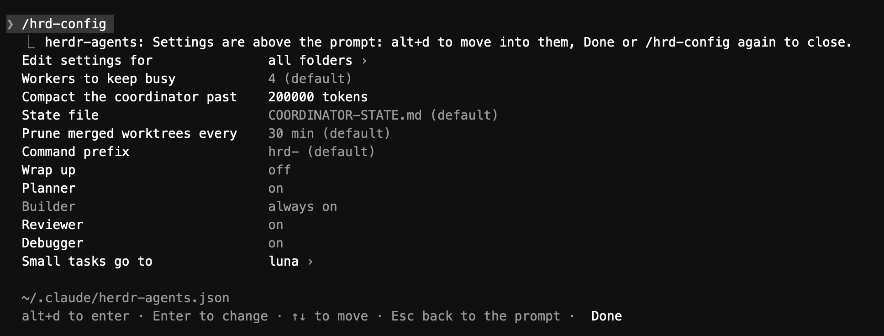

# claude-herdr-orchestrator

Run a team of coding agents from one Claude Code session. The coordinator plans the work, starts workers (Claude, opencode, codex) in [herdr](https://herdr.dev) tabs, and their reports come back to it as prompts. You answer the questions only you can answer from a panel above the prompt.


## What you get

- **Workers in herdr tabs.** The coordinator starts each worker in its own herdr tab, usually in its own git worktree, on any model: Claude, opencode or codex. When a worker finishes, its `RESULT.md` comes back to the coordinator as a prompt, shown as one dim line in the chat (ctrl+o shows it in full).
- **One panel for what needs you.** Above the prompt, in this order: to-dos the coordinator pinned for you (test a build, merge a PR; tick Done when you have), decisions with their options, and the workers with their role, time and state. Answer a decision with `1`–`4` from an empty prompt, alt+d and the arrows, or a click. A `#12` links to that issue or PR.
- **Only your questions reach you.** Workers ask with `DECISION:` lines. The coordinator settles the ones that aren't yours to answer; the panel shows its answer for ten minutes so you can overrule it.
- **Waits without polling.** A worker waiting on CI or a deploy leaves a `WAIT.json` with a check to run; the mod runs it and wakes the worker when it passes. The panel shows the wait (⏸) and what it is for.
- **A playbook.** Planner, builder, reviewer, and a debugger after two failed fix rounds; the coordinator keeps `target` workers busy and is reminded when fewer run.
- **Long sessions stay small.** Past `resetAt` tokens the coordinator saves its state file and is compacted, then reads the state back before the next report.
- **Wrap-up and cleanup.** `/hrd-wrap-up` (or the panel's button) lets running workers finish and starts no new ones; worktrees whose PR merged are removed every half hour.
- **Settings in a list.** `/hrd-config` lays the settings out on the panel, like Claude Code's `/config`:



## What's in the repo

- **`herdr-agents`** (the mod): the `spawn`, `message` and `stop` tools for workers, `ask_owner`, `decided`, `pin_for_owner` and `unpin_for_owner` for the panel, and everything above.
- **`herdr-agents-view`** (`view/`): draws worker reports as one dim line. It has to be a separate mod, because Claude Code never raises a mod's own `ui.render` hooks for the prompts that mod submits.
- **Subagents** (`agents/`): `planner` (Opus), `builder` (Haiku) and `reviewer` (Opus); the `debugger` profile is Opus with full tools. They hold no repo rules of their own: they read the repo's `AGENTS.md`/`CLAUDE.md` and its `.claude/skills` checklists.

## Install (once per machine)

```sh
git clone git@github.com:contursofran/claude-herdr-orchestrator.git
cd claude-herdr-orchestrator && ./install.sh
```

It copies both mods to `~/.claude/mods/`, the subagents to `~/.claude/agents/` (a hand-edited one is kept as `.bak`), creates `~/.claude/herdr-agents.json` if missing, and adds to `~/.claude/settings.json` and `keybindings.json` what loads the mods (`CLAUDE_CODE_PLUGIN_DIRS`), allows their tools (`mcp__herdr-agents`) and binds alt+d to the panel. Run it again after a `git pull` to update. Restart Claude Code sessions afterwards; `/reload-plugins` does not pick up new plugin folders.

## Use it in a repo

1. **Rules.** Add the section in [`templates/AGENTS.md`](templates/AGENTS.md) to the repo's `AGENTS.md` (or `CLAUDE.md`) and fill it in: base branch, checks, how to update a branch, commit identity, who merges, what needs you. Every worker reads it, so this is where repo-specific rules go, not the subagents.
2. **Settings (optional).** A `.claude/herdr-agents.json` in the folder you coordinate from overrides `~/.claude/herdr-agents.json` for that folder, e.g. `{"target": 2}`.
3. **Start.** Inside herdr, open the repo folder and run `claude --model opus --effort medium`, then `/hrd-orchestrate <goal>`, e.g. `/hrd-orchestrate the issues labelled ready`. The session gets the coordinator playbook (state file, worktree per worker, planner → builder → reviewer, when to ask you) and starts workers.
4. **Stop.** `/hrd-wrap-up` (or the panel's Wrap up button) starts no new workers and lets the running ones finish; you get a herdr notification when the last one is done. `/hrd-wrap-up off` (Keep going) resumes.

One coordinator per folder: its notes live in `COORDINATOR-STATE.md` there, and wrap-up applies to the coordinators of that folder.

## Commands

All start with `hrd-` (`commandPrefix` changes it).

| Command | What it does |
| --- | --- |
| `/hrd-orchestrate <goal>` | Make this session the coordinator, with the playbook and a goal. |
| `/hrd-wrap-up`, `/hrd-wrap-up off` | Stop starting workers and let the running ones finish; resume. |
| `/hrd-decisions` | List the questions and to-dos waiting for you. Answer on the panel: `1`–`4` from an empty prompt, or alt+d then arrows and Enter. |
| `/hrd-workers` | List this session's workers. |
| `/hrd-prune` | Remove worktrees whose PR is merged (also runs every `pruneMinutes`). |
| `/hrd-config` | The settings, laid out like `/config`, in the panel above the prompt: alt+d to move into them, ↑↓ to move, Enter to change (a switch flips, a choice steps on, a text opens a field), Done or `/hrd-config` again to close. The first row picks the file: all folders or this folder. Profiles are edited in the file. |
| `/hrd-help`, `/hrd-h` | A short guide: the commands, the panel's keys, and the profiles and settings in effect for this folder. |

## Settings

Change them with `/hrd-config`, or by hand in `~/.claude/herdr-agents.json` (in `$CLAUDE_CONFIG_DIR` when set), with `<folder>/.claude/herdr-agents.json` over it (`profiles` merge by name):

| Key | Default | Meaning |
| --- | --- | --- |
| `target` | `4` | Workers the coordinator keeps busy. |
| `resetAt` | `200000` | Context tokens past which a coordinator saves its state and is compacted. |
| `statePath` | `COORDINATOR-STATE.md` | The state file, relative to the folder (or absolute, or `~/…`). |
| `trustRoots` | the folder and its parent | Folders where a worker's first-run "trust this folder?" prompt is answered for it. |
| `commandPrefix` | `hrd-` | What every slash command starts with. Read when the session starts. |
| `profiles` | see below | Worker profiles by name; one here replaces the built-in of that name. |
| `disable` | none | Built-in profiles to turn off: any of `planner` (the builder plans first), `reviewer` (the coordinator reviews the PR itself), `debugger` (after two failed fix rounds the coordinator asks you). The builder always runs. |
| `smallTasks` | none | A profile the coordinator may give small, well-defined tasks, e.g. `"deepseek"`. |
| `playbook` | none | A line, or a list of lines, added to the coordinator playbook, e.g. `"Label every PR with the issue's area."` |
| `pruneMinutes` | `30` | How often merged worktrees are pruned; `0` turns it off (`/hrd-prune` still works). |
| `repos` | from git remotes | Short names for `#123` links, e.g. `{"web": "owner/website"}`. The repos of the session's and workers' folders are known already, by name and by the part after the last dash (`acme-client`, `client`). |
| `wrapUp` | off | `true` wraps up every coordinator on the machine; `/hrd-wrap-up off` clears it. |

Built-in profiles, the playbook's steps: `planner`, `builder`, `reviewer` (the subagents above) and `debugger` (Opus medium, full tools, for root-cause hunts and fixes that failed twice). A profile of the same name under `profiles` changes its model or flags and keeps its place in the playbook; `/hrd-help` marks it customized. Any other name is a profile of your own. A profile is `{"kind": "claude" | "codex" | "opencode", "args": [...], "env": {...}, "note": "..."}`; `kind` is the CLI herdr starts and `args` its flags. Other CLIs or models are a profile away:

```json
{
  "profiles": {
    "deepseek": {
      "kind": "opencode",
      "args": ["--standalone"],
      "env": { "OPENCODE_CONFIG_CONTENT": "{\"model\": \"opencode-go/deepseek-v4.1-flash\"}" },
      "note": "opencode DeepSeek V4.1 Flash"
    },
    "codex": { "kind": "codex", "args": ["-m", "gpt-6.1-sol", "--approve-for-me"], "note": "codex GPT-6.1 Sol" }
  },
  "smallTasks": "deepseek",
  "disable": ["debugger"]
}
```

## Develop

```sh
npm install
./install.sh && npm run types   # once Claude Code has loaded the mod: the plugin API's types
npm run check                   # formatting, type check, both manifests, tests
```

`npm run check` runs `format:check`, `typecheck`, `validate` and `test`, each also on its own; run it before opening a pull request. After a change, run `./install.sh` again and bump `version` in `.claude-plugin/plugin.json` so running sessions reload the mod.

### Layout

`hooks/register.tsx` wires the engine's events to the modules beside it:

| Module | What it does |
| --- | --- |
| `config.ts` | The settings files, the built-in profiles, the state file's path. |
| `defaults.ts` | Default settings and tuning values. |
| `workers.ts` | `spawn`, `message`, `stop`: starting workers, watching them, delivering `RESULT.md`, `WAIT.json` waits. |
| `owner.ts` | Questions (`ask_owner`, `DECISION:` lines) and to-dos (`pin_for_owner`) waiting for the person. |
| `coordinator.ts` | The playbook, the worker target, wrap-up, and compacting the coordinator's context. |
| `board.ts`, `band.tsx` | The panel above the prompt: what it shows, and drawing it. |
| `settings.tsx` | `/hrd-config`. |
| `commands.ts`, `tools.ts` | The slash commands and the coordinator's tools. |
| `worktrees.ts`, `herdr.ts` | Pruning merged worktrees; the herdr CLI. |

Each module keeps its own state (atoms in `$.state`) and offers functions to the others. Tests live in `tests/`, one file per area over a shared `harness.tsx`.

## License

MIT; see [LICENSE](LICENSE).
